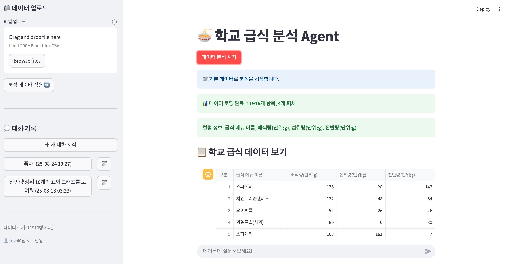

# 🔍 Data Analysis Agent with Streamlit

A powerful data analysis and code execution platform built with LangChain, OpenAI, and Streamlit that helps you analyze data and generate validated Python code using AI Agents.

.svg)



## 🌟 Features

- 🤖 Multiple LLM Support (OpenAI GPT models)
- 🔍 Advanced data analysis capabilities using LangChain
- 📊 Real-time data visualization and analysis
- 📝 Structured data analysis reports
- 🎯 Data-focused analysis and insights
- 🔒 Secure API key management
- 📱 Responsive and modern UI
- 🐍 Python code generation and validation
- ✅ Automatic code error detection and fixing

## 📚 Code Organization

- **Main Application (`app.py`)**:
  - Configures the Streamlit interface
  - Manages the data analysis workflow
  - Handles result display

- **Data Analysis Agent (`src/components/dataanalysis.py`)**:
  - Configures LangChain agents with OpenAI
  - Creates data analysis agents with Python tools
  - Manages data processing and visualization
  - Handles real-time code execution

- **Code Execution Agent (`src/components/code_execution_agent.py`)**:
  - Generates Python code based on user requests
  - Validates and executes code automatically
  - Fixes code errors using AI and pattern matching
  - Provides verified, working code to users

- **Sidebar Component (`src/components/sidebar.py`)**:
  - Handles model selection UI
  - Manages API key input
  - Provides configuration options

- **Output Handler (`src/utils/output_handler.py`)**:
  - Captures and formats analysis process output
  - Manages real-time display updates


## 🛠️ Project Structure

```
DataAgent_streamlit_app/
├── app.py # Main Streamlit application entry point
├── requirements.txt # Project dependencies
└── src/
├── components/
│ ├── dataanalysis.py # Data analysis agent implementation
│ │ # - LangChain agent configuration
│ │ # - Python tool integration
│ │ # - Data processing and visualization
│ ├── code_execution_agent.py # Code generation and validation agent
│ │ # - Python code generation
│ │ # - Code execution and validation
│ │ # - Automatic error fixing
│ └── sidebar.py # Sidebar UI and configuration
│ # - Model selection
│ # - API key management
│ # - Configuration options
├── pages/
│ ├── 00_Main.py # Main data analysis page
│ ├── 01_CSV_Agent.py # CSV data analysis
│ ├── 01_Prepro_Agent.py # Data preprocessing
│ └── 02_Code_Execution_Agent.py # Code execution agent page
└── utils/
└── output_handler.py # Process output management
   # - Real-time output capture
   # - Output formatting
```

## 📋 Requirements

- Python >=3.10 and <3.13
- OpenAI API key
- Streamlit
- pandas, numpy, matplotlib, seaborn

## 🚀 Getting Started

1. Clone the repository:
```bash
git clone <your-repository-url>
cd DataAgent_streamlit_app
```

2. Create and activate a virtual environment:
```bash
python -m venv .venv
source .venv/bin/activate  # On Windows, use `.venv\Scripts\activate`
```

3. Install dependencies:
```bash
pip install -r requirements.txt
```

4. Run the application:
```bash
streamlit run app.py
```

## 🔑 API Keys Setup

The application requires the following API keys:

1. **OpenAI API Key**
   - Get it from [OpenAI Platform](https://platform.openai.com/)
   - Required for AI-powered code generation and analysis

Enter your API key in the sidebar of the application when prompted.

## 🎯 Usage

### Main Data Analysis
1. Open the application in your web browser
2. Enter your OpenAI API key in the sidebar
3. Upload your data file (CSV, Excel) or use sample data
4. Ask questions about your data or request specific analyses
5. View real-time analysis results and visualizations

### Code Execution Agent
1. Navigate to the "Code Execution Agent" page
2. Describe the Python code you need
3. The agent will generate, validate, and fix the code
4. Receive verified, working Python code
5. Use the code for your data analysis tasks

## 💡 Features in Detail

### Data Analysis Agent
The data analysis agent (`src/components/dataanalysis.py`) is powered by LangChain and configured to:
- Analyze data using pandas, numpy, matplotlib, and seaborn
- Generate visualizations and insights
- Handle real-time data processing

### Code Execution Agent
The code execution agent (`src/components/code_execution_agent.py`) provides:
- AI-powered Python code generation
- Automatic code validation and execution
- Intelligent error detection and fixing
- Verified, working code delivery

### Process Output
The output handler (`src/utils/output_handler.py`) provides:
- Real-time process visualization
- Clean, formatted output
- Progress tracking

### User Interface
The application features a modern, responsive UI with:
- Intuitive sidebar configuration
- Clear process visualization
- Organized analysis results
- Professional styling

## 🤝 Contributing

Contributions are welcome! Please feel free to submit a Pull Request.

## 📄 License

This project is licensed under the MIT License - see the LICENSE file for details.

## 🙏 Acknowledgments

- [LangChain](https://langchain.com) for the AI agent framework
- [OpenAI](https://openai.com) for powerful language models
- [Streamlit](https://streamlit.io) for the web interface

---
Made with ❤️ using LangChain, OpenAI, and Streamlit